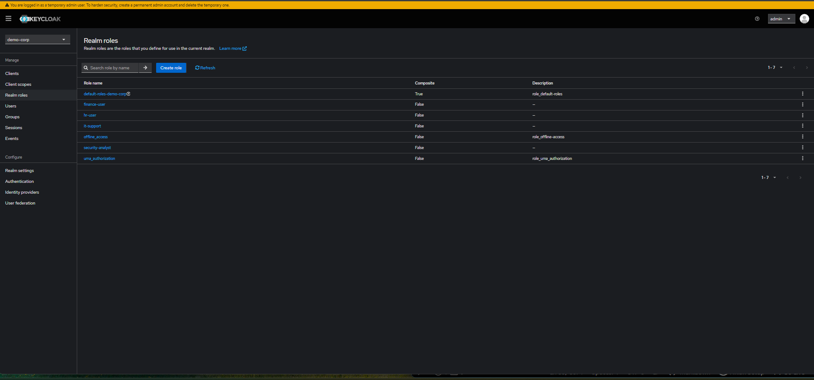
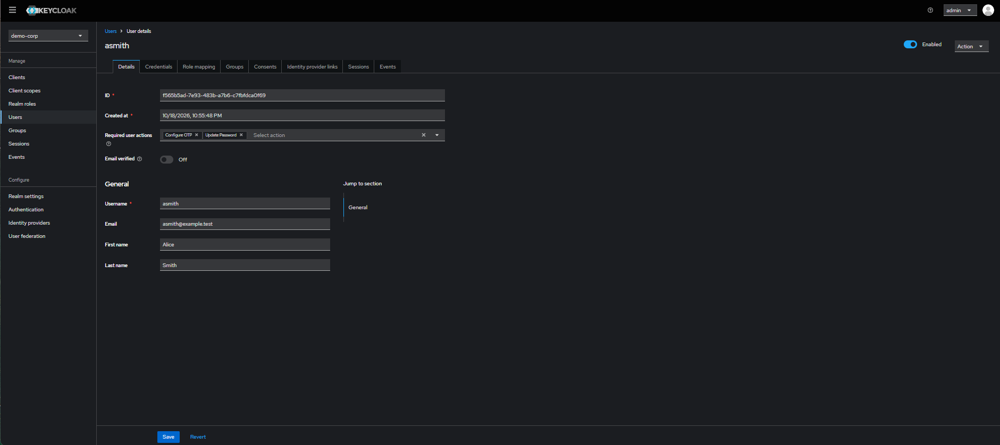
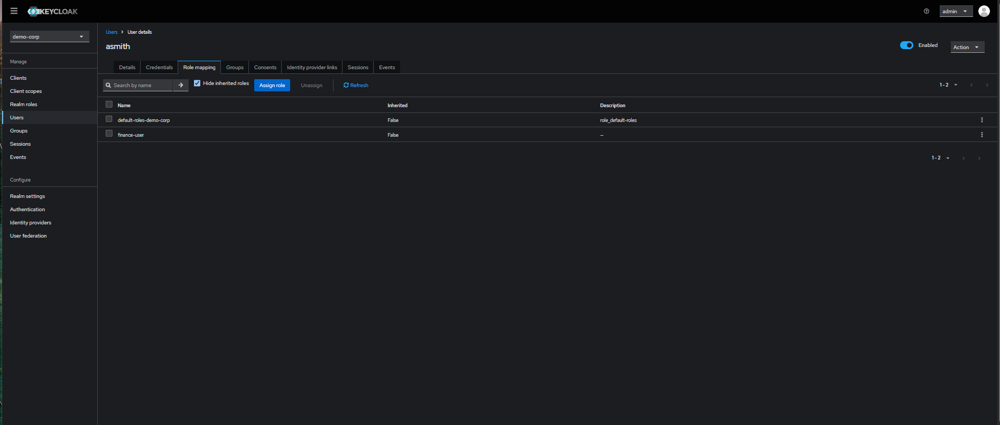
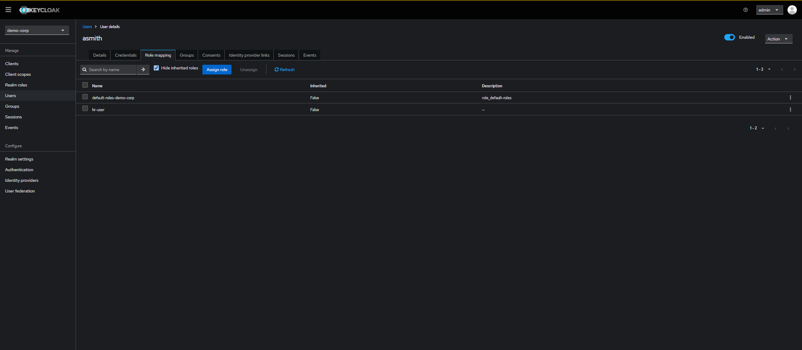
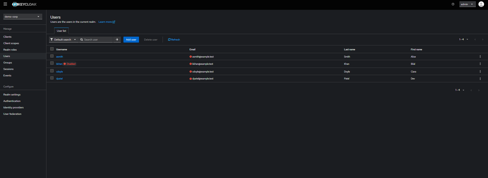
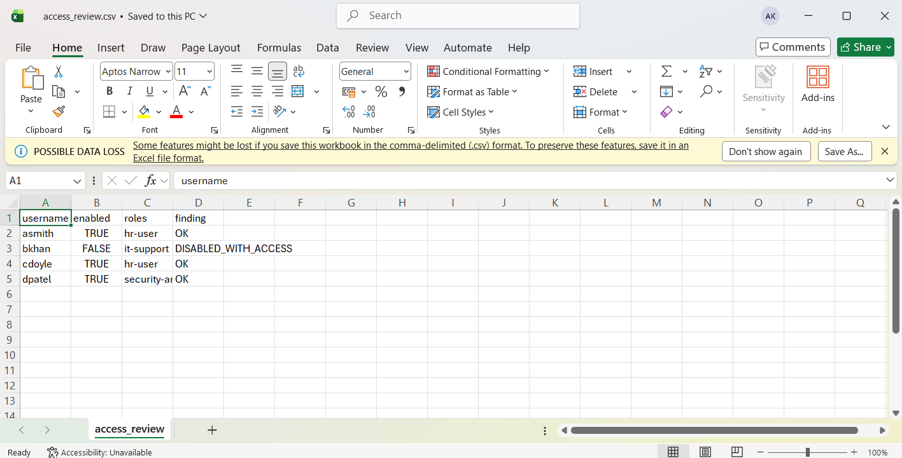
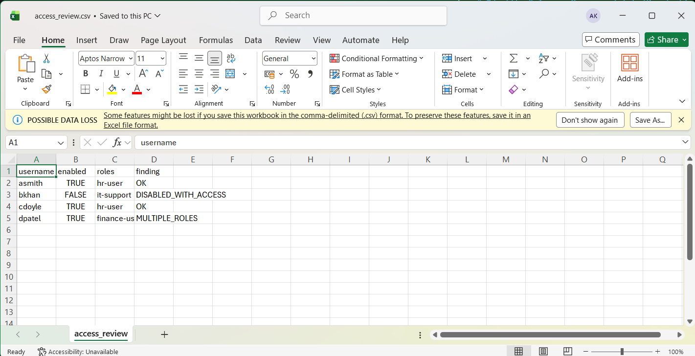
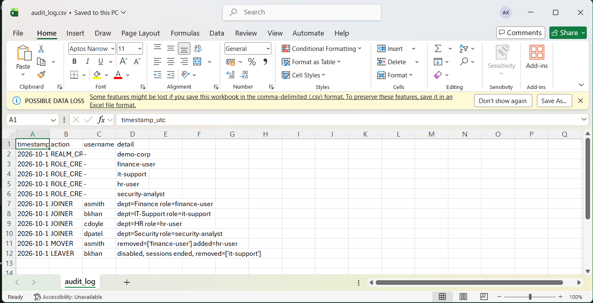

# Identity & Access Management (IAM) Home Lab with Keycloak

A small, hands-on home lab that shows core IAM practice using free, open-source tools:

- **Role-based access control (RBAC):** each department maps to one realm role (least privilege)
- **MFA enrolment:** every new user must set up an authenticator app (TOTP) and change their password at first login
- **Joiner / Mover / Leaver (JML) automation:** Python scripts that create, move and offboard users through the Keycloak Admin API
- **Access review:** a report that flags risky access (disabled accounts that still have roles, users with more than one department role, accounts with no role)
- **Audit trail:** every JML action is written to a timestamped CSV log

> **Note:** This is a learning lab on my own laptop, not a production system. Passwords such as `admin` / `admin` are for local testing only. Never expose this setup to the internet.

Built by **Ajay Kumar Reddy Konduri** (MSc Cyber Security student, Dublin) while learning identity and access management.

---

## Contents

1. [What each part does](#1-what-each-part-does)
2. [How it fits together](#2-how-it-fits-together)
3. [Requirements](#3-requirements)
4. [Step-by-step: how I built and ran it](#4-step-by-step-how-i-built-and-ran-it)
5. [Evidence (screenshots)](#5-evidence-screenshots)
6. [Lessons learned](#6-lessons-learned)
7. [Limitations and next steps](#7-limitations-and-next-steps)
8. [Troubleshooting](#8-troubleshooting)
9. [Push this project to GitHub](#9-push-this-project-to-github)
10. [Project files](#10-project-files)

---

## 1. What each part does

| Part | What it is | Why it matters |
|---|---|---|
| **Keycloak** | Open-source identity provider, runs in Docker at http://localhost:8080 | Stores users, passwords, roles and login rules, like Entra ID or Okta do in a company |
| **Realm `demo-corp`** | A separate space inside Keycloak for my fake company | Keeps lab users apart from the admin account |
| **Roles** | `finance-user`, `it-support`, `hr-user`, `security-analyst` | One role per department keeps access simple and minimal |
| **`jml.py`** | Joiner / Mover / Leaver automation | Onboarding and offboarding are where most access mistakes happen |
| **`access_review.py`** | Access review report | Finds accounts that keep access they should not have |
| **`audit_log.csv`** | Log of every action (created when you run the scripts) | Shows who changed what and when |

## 2. How it fits together

```
 users.csv ──► jml.py ───────► Keycloak Admin API ──► realm "demo-corp"
 (new starters)   │                                     ├─ users
                  │                                     ├─ roles (RBAC)
                  ▼                                     └─ MFA required actions
             audit_log.csv
                                                              │
 access_review.py ◄───────────────────────────────────────────┘
        │
        ▼
 access_review.csv   (flags: DISABLED_WITH_ACCESS, MULTIPLE_ROLES, NO_ROLE)
```

- **Joiner:** creates the user, sets a temporary password, requires MFA setup and assigns the role for their department.
- **Mover:** removes the old department role and adds the new one, so access does not pile up.
- **Leaver:** disables the account, ends active sessions and removes the role.

## 3. Requirements

- Windows, macOS or Linux
- [Docker Desktop](https://www.docker.com/products/docker-desktop/) (running)
- [Python 3.10+](https://www.python.org/downloads/) (I used Python 3.13)
- [Git](https://git-scm.com/downloads) (only to publish to GitHub)

Check your installs first:

```
python --version
docker --version
docker compose version
docker run hello-world
```

`docker run hello-world` must print "Hello from Docker!". If it errors, open Docker Desktop and wait until it says **Engine running**.

## 4. Step-by-step: how I built and ran it

All commands below are for Windows (PowerShell or Command Prompt) and run from the project folder, the one that contains `docker-compose.yml`.

### Step 1 - Open the project folder
```
cd C:\Users\<you>\Downloads\iam-keycloak-lab
dir
```
You should see `docker-compose.yml`, `jml.py`, `common.py`, `access_review.py`, `users.csv`. If you do not, you are one folder too high or too low (some unzip tools create a folder inside a folder), so `cd` into the inner one.

### Step 2 - Start Keycloak in Docker
```
docker compose up -d
docker compose ps
```
The first run downloads the Keycloak image (a few hundred MB). `docker compose ps` should show the container as `Up`. Wait about a minute, then open http://localhost:8080 and sign in with `admin` / `admin`.

### Step 3 - Set up Python
```
python -m venv .venv
.venv\Scripts\activate
pip install -r requirements.txt
```
(macOS/Linux: `source .venv/bin/activate`.) The prompt should start with `(.venv)`. If PowerShell blocks the activate script, run `Set-ExecutionPolicy -Scope Process Bypass` and try again.

### Step 4 - Create the realm and roles
```
python jml.py setup
```
Expected output:
```
[REALM_CREATED] - demo-corp
[ROLE_CREATED] - finance-user
[ROLE_CREATED] - it-support
[ROLE_CREATED] - hr-user
[ROLE_CREATED] - security-analyst
```
In Keycloak, switch the realm dropdown (top left) to `demo-corp` and open **Realm roles** to see them (screenshot 01).

### Step 5 - Onboard the users (Joiners)
`users.csv` holds four fake starters, one per department.
```
python jml.py joiners users.csv
```
Expected output: four `[JOINER]` lines. In Keycloak, open **Users**, click `asmith`:
- **Details** shows *Required user actions: Configure OTP, Update Password* (screenshot 02)
- **Role mapping** shows `finance-user` (screenshot 03)

### Step 6 - Move a user to another department (Mover)
```
python jml.py mover asmith HR
```
Expected: `[MOVER] asmith removed=['finance-user'] added=hr-user`. Refresh **Role mapping** and the role is now `hr-user` only (screenshot 04).

### Step 7 - Offboard a user (Leaver)
```
python jml.py leaver bkhan
```
Expected: `[LEAVER] bkhan disabled, sessions ended, removed=['it-support']`. In the user list, `bkhan` now shows **Disabled** (screenshot 05).

### Step 8 - Run the access review on clean data
```
python access_review.py
```
My first run printed `Reviewed 4 accounts, 0 findings`. That is correct, because the scripts had cleaned up properly. But a report that finds nothing does not prove it works, so I tested it with deliberate mistakes.

### Step 9 - Test the review with deliberate mistakes
**Mistake 1 - disabled account that still has access.**
In Keycloak, open `bkhan` > **Role mapping** > **Assign role** > change the filter to *Filter by realm roles* > tick `it-support` > **Assign**. Then:
```
python access_review.py
```
Result: `1 findings`, and `bkhan` is flagged `DISABLED_WITH_ACCESS` (screenshot 06).

**Mistake 2 - privilege creep.**
Give `dpatel` the extra role `finance-user` the same way, then run the review again. Result: `dpatel` is flagged `MULTIPLE_ROLES` (screenshot 07).

**Fix and re-check.** Remove the extra roles (**Role mapping** > tick the role > **Unassign**), run the review again, and confirm it returns to 0 findings.

### Step 10 - Check the audit log
Open `audit_log.csv`. Every realm, role, joiner, mover and leaver action is there with a UTC timestamp (screenshot 08).

### Stop the lab
```
docker compose down
```

---

## 5. Evidence (screenshots)

**01 - Realm roles created by `jml.py setup`**



**02 - New user must configure OTP (MFA) and update password**



**03 - `asmith` as a Finance joiner: `finance-user`**



**04 - After the mover script: `hr-user` only**



**05 - After the leaver script: `bkhan` is disabled**



**06 - Access review catches a disabled account that still has a role**



**07 - Access review also flags a user with more than one role**



**08 - Audit log of every action**



---

## 6. Lessons learned

- **Offboarding is more than disabling an account.** A disabled account that still holds a role is a real risk. If someone re-enables it by mistake, the old access comes back. The leaver script ends sessions and removes roles too.
- **Movers cause "privilege creep".** If you only add the new role and forget to remove the old one, access piles up. The mover script removes the old role first.
- **A clean report proves nothing by itself.** My first access review showed 0 findings. I only trusted it after I created two mistakes on purpose and the report caught both.
- **Automation needs an audit trail.** Writing every action to a log makes it possible to answer "who changed what, and when?"
- **Practical issues I hit:** the unzipped folder was nested one level deeper than expected, and Docker Desktop must be fully running before `docker compose` works.

## 7. Limitations and next steps

**Limitations (be honest about the scope):**
- Lab only: default admin credentials, one container, no HTTPS, no backups.
- The access review checks realm roles only. It does not look at groups, client roles or application-level permissions.
- Keycloak is not the tool every company uses (many use Microsoft Entra ID, Okta or SailPoint). The concepts transfer, the screens do not.
- I have not used this in a production environment.

**Next steps I would like to add:**
- Protect a small sample app with single sign-on (OIDC)
- Use groups instead of direct role assignment
- Connect an LDAP directory (closest to Active Directory)
- Run the access review on a schedule and email the findings
- Add automated tests for the scripts

## 8. Troubleshooting

| Problem | Fix |
|---|---|
| `docker compose` says it cannot connect to the daemon / pipe | Open Docker Desktop and wait for **Engine running** |
| `dir` does not show `docker-compose.yml` | You are in the wrong folder. `cd` into the inner `iam-keycloak-lab` folder |
| `python jml.py setup` says *connection refused* | Keycloak is still starting. Wait one minute and retry |
| PowerShell blocks `.venv\Scripts\activate` | `Set-ExecutionPolicy -Scope Process Bypass`, then activate again |
| `Realm already exists` | Fine. The setup script can be run more than once |
| Port 8080 already in use | Stop the other program or change `8080:8080` in `docker-compose.yml` to `8081:8080` and set `KC_URL=http://localhost:8081` |
| Start again from scratch | `docker compose down -v`, then repeat from Step 2 |


## 9. Project files

```
iam-keycloak-lab/
├── README.md             this file
├── docker-compose.yml    runs Keycloak in Docker
├── requirements.txt      Python dependency (requests)
├── users.csv             four fake new starters
├── common.py             Keycloak API helper and audit logging
├── jml.py                joiner / mover / leaver automation
├── access_review.py      access review report
├── screenshots/          evidence images used in this README
├── LICENSE               MIT licence
└── .gitignore            keeps logs, venv and secrets out of Git
```

## Skills practised
Identity and access management, RBAC and least privilege, MFA, joiner/mover/leaver processes, access reviews, audit logging, Python scripting, REST APIs, Docker, Git and GitHub.
